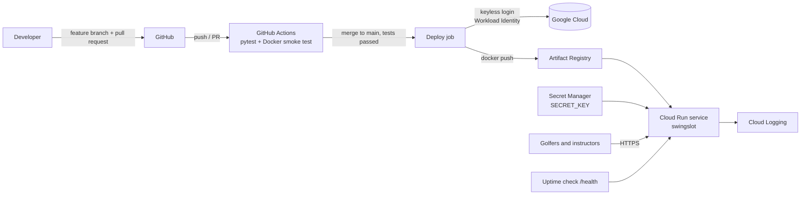
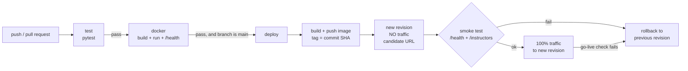

# SwingSlot ⛳ - Golf Lesson Booking App

[](https://github.com/AdrianSVFC/swingslot/actions/workflows/ci-cd.yml)

SwingSlot makes booking golf lessons simple for golfers and instructors. Instructors publish their profile and open time slots. Golfers browse instructors, book a slot, cancel it if plans change and read the notes their instructor writes after each lesson.

**Live app (Google Cloud Run):** https://swingslot-c7e7psvzfq-uc.a.run.app
*The service scales to zero when nobody is using it, so the first visit after a quiet period can take a few seconds.*

**Status:** Final project complete (Unit 14).
- Sprint 1 (MVP): 7 user stories
- Sprint 2 (CI/CD): automated tests, Docker checks and automatic, safe deployment to Google Cloud
- Sprint 3: 3 features beyond the MVP
- 54 automated tests run on every push

---

## Contents
- [Try it](#try-it)
- [Features](#features)
- [Tech stack](#tech-stack)
- [Architecture](#architecture)
- [Run it locally](#run-it-locally)
- [Run the tests](#run-the-tests)
- [Docker](#docker)
- [CI/CD pipeline](#cicd-pipeline)
- [Google Cloud deployment](#google-cloud-deployment)
- [Troubleshooting](#troubleshooting)
- [Git workflow](#git-workflow)
- [AI tool usage](#ai-tool-usage)
- [Project management](#project-management)
- [Roadmap](#roadmap)

---

## Try it

The live database is filled with demo data every time the app starts.

| Role | Email | Password |
|------|-------|----------|
| Golfer | `golfer@swingslot.demo` | `swingslot123` |
| Instructor | `mark@swingslot.demo` | `swingslot123` |

You can also sign up with your own email as a golfer or an instructor. Demo data is reset on every deploy (see [limits](#limits-and-decisions)).

**Main workflow in 1 minute:**
1. Log in as the golfer.
2. Open **Instructors**, filter by location or lesson type, and book an open slot.
3. On **Dashboard**, cancel a lesson that is more than 24 hours away.
4. Open **My profile** and set your handicap and goals.
5. Log in as Mark (instructor). The dashboard shows the golfer's level, handicap and goals next to each lesson. Mark can add notes to past lessons.

## Features

### Sprint 1 - MVP (Unit 12)
| Jira | Feature |
|------|---------|
| GOLF-2 | Sign up and log in as a golfer |
| GOLF-7 | Sign up as an instructor and set up a profile (location, bio, lesson types, price) |
| GOLF-12 | Hashed passwords, log out, role-based access, CSRF protection |
| GOLF-22 | Instructors add and remove time slots (past and duplicate times are rejected) |
| GOLF-27 | Browse instructors, filter by location and lesson type, live course weather (Open-Meteo API) |
| GOLF-32 | Book an open slot; the database blocks double bookings |
| GOLF-42 | Dashboards with upcoming and past lessons for golfers and instructors |

### Sprint 2 - Production ready (Unit 13)
| Jira | What was added |
|------|----------------|
| GOLF-68 | GitHub Actions runs pytest and a Docker smoke test on every push and pull request; `main` is protected |
| GOLF-72 | Deployed to **Google Cloud Run** (Artifact Registry, Secret Manager, keyless login from GitHub) |
| GOLF-76 | Automatic deployment on every merge to `main`, only after all tests pass |
| GOLF-79 | Safe rollout: new revision gets no traffic until it passes a smoke test; automatic rollback |
| GOLF-82 | Logs in Cloud Logging and a Cloud Monitoring uptime check on `/health` |

### Sprint 3 - Features beyond the MVP (Unit 14)
| Jira | Feature |
|------|---------|
| GOLF-37 | **Cancel a lesson** up to 24 hours before it starts (with a confirmation dialog). The slot opens again and the instructor sees the cancellation. |
| GOLF-17 | **Golfer profile** with handicap (0-54), level and goals. Instructors see it next to each booked lesson. |
| GOLF-48 | **Lesson notes**: after a lesson the instructor writes what they worked on; only that golfer can read them. |

## Tech stack

| Layer | Technology |
|-------|------------|
| Backend | Python 3.12, Flask 3, Jinja2 templates |
| Database | SQLite (built-in `sqlite3` module; `app/schema.sql` + `app/migrations.sql`) |
| Frontend | HTML, CSS, Bootstrap 5, a little JavaScript (weather widget, cancel confirmation) |
| External API | Open-Meteo (weather, no key needed) |
| Testing | pytest (54 tests) |
| Container | Docker (`python:3.12-slim`, gunicorn, non-root user, HEALTHCHECK) |
| CI/CD | GitHub Actions (`.github/workflows/ci-cd.yml`) |
| Hosting | Google Cloud Run (us-central1), Artifact Registry, Secret Manager, Cloud Logging, Cloud Monitoring |
| Project management | Jira (Scrum, 3 sprints) and Confluence |

## Architecture



**Inside the app**, each Jira feature has its own Flask blueprint:

```
swingslot/
├── .github/workflows/ci-cd.yml   # test -> docker -> deploy pipeline
├── app/
│   ├── __init__.py        # app factory, CSRF, template helpers, /health
│   ├── db.py              # SQLite connection, init-db command, migrations
│   ├── schema.sql         # MVP tables: users, instructor_profiles, time_slots, bookings
│   ├── migrations.sql     # Sprint 3 tables: cancellations, student_profiles, lesson_notes
│   ├── seed.py            # demo instructors, slots and golfer (with a profile)
│   ├── auth.py            # GOLF-2, GOLF-12: register, login, logout, role_required
│   ├── instructors.py     # GOLF-7: instructor profile
│   ├── slots.py           # GOLF-22: add/remove time slots
│   ├── bookings.py        # GOLF-27, GOLF-32, GOLF-37: browse, book, cancel
│   ├── dashboard.py       # GOLF-42: dashboards (+ cancellations, golfer profiles, notes)
│   ├── golfers.py         # GOLF-17: golfer profile
│   ├── notes.py           # GOLF-48: lesson notes
│   ├── templates/         # Jinja2 pages
│   └── static/            # css/styles.css, js/weather.js
├── scripts/gcp-setup.sh   # one-time Google Cloud setup (run in Cloud Shell)
├── tests/                 # pytest tests, one file per feature
├── Dockerfile
├── requirements.txt
└── run.py
```

The `index.html`, `css/`, `js/` and `data/` folders in the root are the early static prototype (GitHub Pages: https://adriansvfc.github.io/swingslot/). The Flask app does not use them.

**Architecture decisions** (details in Confluence):

| Decision | Why |
|----------|-----|
| Flask blueprints, one per user story | Each feature branch only touches its own module; easy to review and test |
| `sqlite3` + Flask sessions instead of SQLAlchemy/Flask-Login | Fewer dependencies for a small app |
| `UNIQUE(slot_id)` on bookings | The database itself blocks double bookings, even with two requests at the same time |
| `migrations.sql` with `CREATE TABLE IF NOT EXISTS` | New tables are added on start-up without deleting existing data |
| Cloud Run instead of Compute Engine / GKE | Runs our Docker image directly, HTTPS included, scales to zero (free tier) |
| Workload Identity Federation instead of a JSON key | No long-lived secret stored in GitHub; only this repository can deploy |
| `SECRET_KEY` in Secret Manager | The real key never appears in GitHub, the image or the logs |
| No-traffic candidate revision + smoke test | A broken build never receives users' traffic |

## Run it locally

```bash
git clone https://github.com/AdrianSVFC/swingslot.git
cd swingslot
python -m venv venv
source venv/bin/activate          # Windows: venv\Scripts\activate
pip install -r requirements.txt
python run.py                     # http://localhost:5000
```

The SQLite database is created in `instance/` with demo data the first time the app starts. To reset it: `flask --app app init-db`.

### Environment variables

| Variable | Default | Purpose |
|----------|---------|---------|
| `SECRET_KEY` | dev-only value | Signs session cookies. **Production reads it from Secret Manager.** |
| `DATABASE_PATH` | `instance/swingslot.sqlite` | Where the SQLite file lives |
| `SEED_DEMO_DATA` | `1` | Load demo data into a new database |
| `DEMO_PASSWORD` | `swingslot123` | Password for the demo accounts |
| `APP_VERSION` | `dev` | Shown by `/health`; the deploy job sets it to the short commit SHA |
| `PORT` | `8000` (Docker) / `5000` (`run.py`) | Port the server listens on (Cloud Run sets it) |

No credentials are stored in the repository.

## Run the tests

```bash
pytest -v
```

54 tests, one file per feature:

| File | What it covers |
|------|----------------|
| `test_auth.py` | sign-up, login, password hashing, CSRF |
| `test_instructors.py` | instructor profile |
| `test_slots.py` | add and remove slots, past or duplicate times rejected |
| `test_bookings.py` | browse, filters, booking, double booking |
| `test_dashboard.py` | both dashboards |
| `test_cancellations.py` | 24-hour rule, reopening the slot, permissions, instructor view |
| `test_golfer_profile.py` | handicap parsing, validation, permissions, instructor view |
| `test_lesson_notes.py` | add/edit notes, validation, permissions, HTML escaping |

## Docker

```bash
docker build -t swingslot .
docker run -p 8000:8000 -e SECRET_KEY=change-me swingslot
# open http://localhost:8000  -  health: http://localhost:8000/health
```

Notes about the container:
- Dependencies are installed in their own layer, so rebuilding after a code change is fast. `.dockerignore` keeps tests, the prototype and local databases out of the image.
- The app runs as a non-root user (`appuser`).
- gunicorn listens on `$PORT` (Cloud Run sets it; the default is 8000). One worker with 4 threads, so only one process creates the SQLite database.
- Access and error logs go to stdout/stderr, which is what Cloud Logging collects.
- `HEALTHCHECK` calls `/health` every 30 s (`docker ps` shows `healthy`).
- Works the same on macOS, Windows (Docker Desktop) and Linux. The image is built and started by CI on Ubuntu for every push. On Apple Silicon, use `docker build --platform linux/amd64 ...` if you want the exact image Cloud Run runs.

## CI/CD pipeline

File: [`.github/workflows/ci-cd.yml`](.github/workflows/ci-cd.yml)



| Job | Runs on | What it does |
|-----|---------|--------------|
| `test` | every push, every PR to main | `pip install`, `pytest -v`, uploads a JUnit report |
| `docker` | after `test` passes | builds the image, starts it, waits for `/health`, checks the main pages, prints container logs |
| `deploy` | pushes to `main` only, after `test` **and** `docker` pass | builds and pushes to Artifact Registry, safe rollout to Cloud Run, rollback on failure |

**Failure handling**
- A failing test stops the pipeline before Docker; a failing container stops it before deploy.
- **Branch protection on `main`:** changes must come through a pull request, and the *Unit tests (pytest)* and *Docker build and smoke test* checks must pass before merging.
- The new Cloud Run revision starts with **no traffic** and is tested on its own `candidate---` URL. If the smoke test fails, users never see it.
- If anything fails after that, the **Roll back** step sends 100% of traffic to the revision that was live before.
- Older runs of the same branch are cancelled when a new commit arrives (runs on `main` are never cancelled).

**Configuration.** Repository *variables* (Settings → Secrets and variables → Actions → Variables). None of them are secret:

| Variable | Example / meaning |
|----------|-------------------|
| `GCP_PROJECT_ID` | `project-92a4b1e0-49fb-4dc8-bd3` |
| `GCP_REGION` | `us-central1` |
| `GCP_WIF_PROVIDER` | Workload Identity provider that trusts this GitHub repository |
| `GCP_DEPLOY_SA` | `github-deployer@…` service account used by the deploy job |
| `GCP_RUNTIME_SA` | `swingslot-runtime@…` service account the app runs as |

There are **no GitHub secrets**. GitHub proves its identity to Google with a short-lived OIDC token (Workload Identity Federation), and the app's `SECRET_KEY` lives in Google Secret Manager.

**Manual operations**
- Re-run a deploy: *Actions → CI/CD → Run workflow* on `main`.
- Manual rollback:
  ```bash
  gcloud run revisions list --service swingslot --region us-central1
  gcloud run services update-traffic swingslot --region us-central1 --to-revisions REVISION_NAME=100
  ```

## Google Cloud deployment

| Resource | Name | Purpose |
|----------|------|---------|
| Cloud Run service | `swingslot` (us-central1) | runs the container, HTTPS URL, 0–1 instances, 512 MiB |
| Artifact Registry | `swingslot` (Docker) | one image per commit SHA |
| Secret Manager | `flask-secret-key` | Flask `SECRET_KEY`, mounted as an env var |
| Service account | `swingslot-runtime` | identity of the running app (can only read its secret) |
| Service account | `github-deployer` | used by GitHub Actions: Cloud Run Admin, Artifact Registry Writer, "act as" runtime only |
| Workload Identity pool | `github` / provider `swingslot-repo` | accepts tokens only from `AdrianSVFC/swingslot` |
| Uptime check | `swingslot-health` | Cloud Monitoring calls `/health` every 15 minutes |

**One-time setup:** run [`scripts/gcp-setup.sh`](scripts/gcp-setup.sh) in Cloud Shell, then add the 5 variables it prints to GitHub. The script is idempotent, so it is safe to run again.

**Monitoring and logging**
- **Logs:** Cloud Run → `swingslot` → *Logs*, or Logs Explorer with `resource.type="cloud_run_revision"`. The logs include gunicorn access logs (one line per request) and errors.
- **Metrics:** Cloud Run → *Metrics* (requests, latency, instances, memory).
- **Uptime:** Monitoring → *Uptime checks* → `swingslot-health`.
- **Which commit is live?** `curl https://swingslot-c7e7psvzfq-uc.a.run.app/health` returns `{"status": "ok", "version": "<short SHA>"}`.

### Limits and decisions
- **SQLite on Cloud Run is not permanent storage.** Every new revision or cold start creates a fresh database with demo data. This is fine for a demo, but real use needs Cloud SQL (PostgreSQL). That's planned as GOLF-66.
- `--max-instances 1` keeps all users on the same SQLite file while an instance is running.
- Cost: the app fits in the Cloud Run free tier (scale to zero, 512 MiB).
- Sprint 1 was deployed on Render. Since Sprint 2 the official deployment is Google Cloud Run.

## Troubleshooting

| Problem | Fix |
|---------|-----|
| `ModuleNotFoundError: flask` | Activate the virtualenv and run `pip install -r requirements.txt` |
| `400 Bad Request: Invalid or missing CSRF token` | Forms need the hidden `csrf_token`; reload the page (the session may have expired) |
| `sqlite3.OperationalError: no such table` | Run `flask --app app init-db` (or delete `instance/swingslot.sqlite`) |
| Demo data is old or empty locally | `flask --app app init-db` resets the database and reloads demo data |
| Docker: port already in use | `docker run -p 8080:8000 …` and open http://localhost:8080 |
| Docker container `unhealthy` | `docker logs <container>`; check that `SECRET_KEY` is set and port 8000 is free |
| CI fails in `test` | Open the run, read the failing test in the *Run tests* step, reproduce with `pytest -v -k <name>` |
| CI fails in `docker` | The *Show container logs* step prints gunicorn's error |
| Deploy fails at *Log in to Google Cloud* | Check the 5 repository variables and that the workflow has `id-token: write` |
| Deploy fails at *Smoke test* | The new revision was never given traffic; check Cloud Run logs for that revision |
| Live site shows data reset | Expected after a deploy or cold start (see limits) |
| Can't merge a PR | Branch protection: wait for both checks to pass, or click *Update branch* if `main` moved |

## Git workflow

Every user story was built on its own feature branch with small, descriptive commits, then merged into `main` through a pull request with a detailed description. Since Sprint 2, `main` is protected and requires passing CI checks.

| Sprint | Pull request | Branch | Jira |
|--------|--------------|--------|------|
| 1 | [#1](https://github.com/AdrianSVFC/swingslot/pull/1) | `feature/GOLF-2-GOLF-12-accounts` | GOLF-2, GOLF-12 |
| 1 | [#2](https://github.com/AdrianSVFC/swingslot/pull/2) | `feature/GOLF-7-instructor-profile` | GOLF-7 |
| 1 | [#3](https://github.com/AdrianSVFC/swingslot/pull/3) | `feature/GOLF-22-instructor-availability` | GOLF-22 |
| 1 | [#4](https://github.com/AdrianSVFC/swingslot/pull/4) | `feature/GOLF-27-GOLF-32-browse-and-book` | GOLF-27, GOLF-32 |
| 1 | [#5](https://github.com/AdrianSVFC/swingslot/pull/5) | `feature/GOLF-42-dashboards` | GOLF-42 |
| 1 | [#6](https://github.com/AdrianSVFC/swingslot/pull/6) | `feature/docker-containerization` | GOLF-46 |
| 1 | [#7](https://github.com/AdrianSVFC/swingslot/pull/7) | `docs/readme-sprint-1` | - |
| 2 | [#8](https://github.com/AdrianSVFC/swingslot/pull/8) | `feature/GOLF-68-ci-tests` | GOLF-68 |
| 2 | [#9](https://github.com/AdrianSVFC/swingslot/pull/9) | `feature/GOLF-72-cloud-run-deploy` | GOLF-72, GOLF-76, GOLF-79, GOLF-82 |
| 3 | [#10](https://github.com/AdrianSVFC/swingslot/pull/10) | `feature/GOLF-37-cancel-booking` | GOLF-37 |
| 3 | [#11](https://github.com/AdrianSVFC/swingslot/pull/11) | `feature/GOLF-17-golfer-profile` | GOLF-17 |
| 3 | [#12](https://github.com/AdrianSVFC/swingslot/pull/12) | `feature/GOLF-48-lesson-notes` | GOLF-48 |
| 3 | this README | `docs/GOLF-78-final-readme` | GOLF-78, GOLF-85 |

## AI tool usage

**Tool used:** Claude (Anthropic), as an AI pair programmer in all three sprints. Since Sprint 2, commits made with Claude's help carry a `Co-Authored-By: Claude` trailer, so the AI's part is visible in the Git history. Code that is mostly AI-generated says so in a comment at the top of the file: the workflow, `scripts/gcp-setup.sh`, `app/golfers.py`, `app/notes.py`, the cancellation section of `app/bookings.py` and the Sprint 3 test files.

### What it was used for

| Sprint | AI-assisted work |
|--------|------------------|
| 1 | Flask blueprints, SQL schema, Jinja templates, CSS, weather script, pytest suite, Dockerfile, README |
| 2 | GitHub Actions workflow (test, Docker smoke test, deploy with rollback), Google Cloud setup script (least-privilege IAM, Workload Identity, Secret Manager), Dockerfile logging/HEALTHCHECK |
| 3 | Cancellations, golfer profile and lesson notes (routes, templates, migrations) and their 29 tests; this README; Jira stories and Confluence pages |

### Specific examples

**1. Safe deploy step (AI-generated, `.github/workflows/ci-cd.yml`).** Claude suggested deploying the new revision with no traffic and smoke-testing it before it goes live:
```bash
# Later deploys: start the new revision with NO traffic and a "candidate" URL
gcloud run deploy "$SERVICE" "${ARGS[@]}" --no-traffic --tag candidate --quiet
```

**2. A bug caught while reviewing AI output.** The first draft of the rollback step remembered the live revision with `status.traffic[0].revisionName`. Once a `candidate` tag exists, the first traffic entry can be the tag (0% traffic), so a rollback would have gone to the wrong revision. This was fixed before the first deploy by picking the revision that has 100% of the traffic:
```bash
PREV=$(echo "$SERVICE_JSON" | jq -r '[.status.traffic[]? | select(.percent == 100)][0].revisionName // empty')
```

**3. Cancellation rule as a small, testable function (AI-generated, `app/bookings.py`).**
```python
@bp.app_template_global()
def can_cancel(starts_at, now=None):
    now = now or datetime.now()
    starts = datetime.strptime(starts_at, "%Y-%m-%dT%H:%M")
    return starts - now >= timedelta(hours=CANCEL_NOTICE_HOURS)
```
Because `now` can be passed in, the test checks the exact 24-hour boundary without waiting for real time.

**4. Test data that would have been flaky.** One AI-written test expected `parse_handicap("7,25") == 7.2`. That only works because of Python's round-half-to-even rule, which is easy to misread, so the test case was changed to `"7,3" → 7.3`.

**5. Database safety (AI-generated, `app/bookings.py`, Sprint 1).** Double bookings are stopped by a `UNIQUE` constraint in the database instead of a check in Python:
```python
try:
    db.execute("INSERT INTO bookings (slot_id, student_id) VALUES (?, ?)", (slot_id, g.user["id"]))
    db.commit()
except sqlite3.IntegrityError:
    # UNIQUE(slot_id) failed: someone else booked it a moment earlier
    flash("Sorry, that slot was just booked by someone else.", "warning")
```

**How it changed the process:** the AI made it fast to produce the workflow YAML, cloud setup and tests. These are the parts the course says not to write from scratch. The trade-off is that every AI-generated piece has to be read and understood before it is merged; example 2 shows why. The CI pipeline makes that safer, because AI-written code has to pass the same 54 tests as everything else.

## Project management

- Jira board (3 sprints, stories, sub-tasks, time tracking): https://swingslot-project.atlassian.net/jira/software/c/projects/GOLF/boards/2
- Confluence space (sprint reports, retrospectives, decisions): https://swingslot-project.atlassian.net/wiki/spaces/SWING/overview

## Roadmap

Moved to the backlog after Sprint 3 (reasons in Confluence):
- GOLF-52 / GOLF-57 / GOLF-61: AI lesson summaries, practice plans and history with the OpenAI API (needs a paid API key)
- GOLF-66: PostgreSQL (Cloud SQL) so data survives deploys
- GOLF-65: lesson duration and lesson type on each slot

## Author

Adrian Perez Fernandez, Computer Science student, Blue Mountain Christian University.
